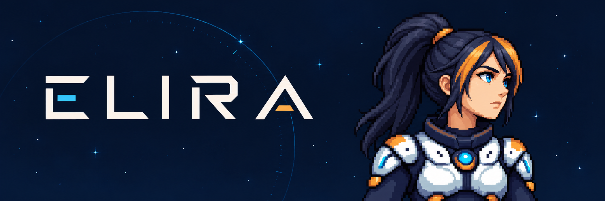
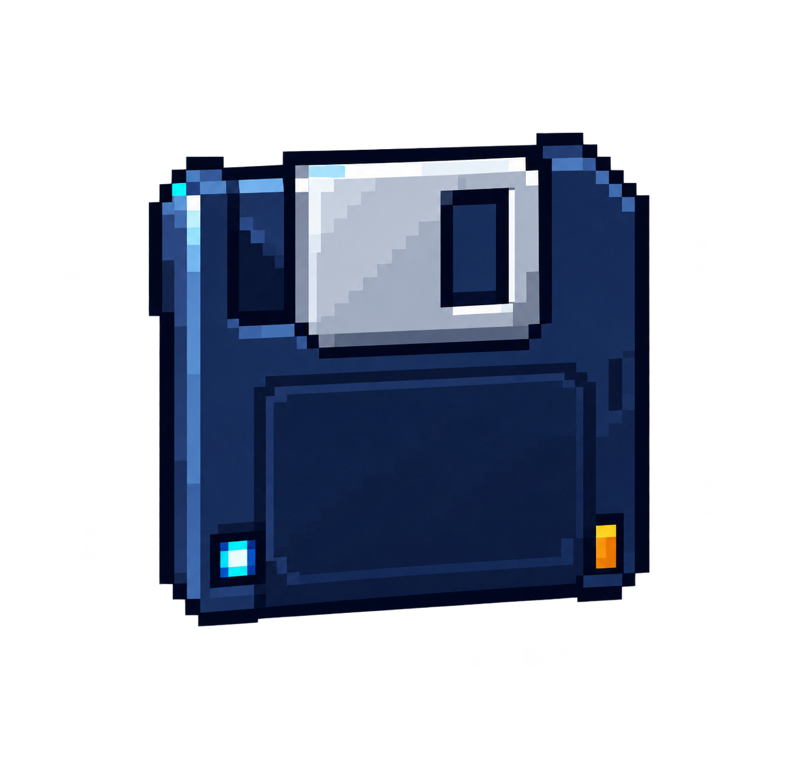
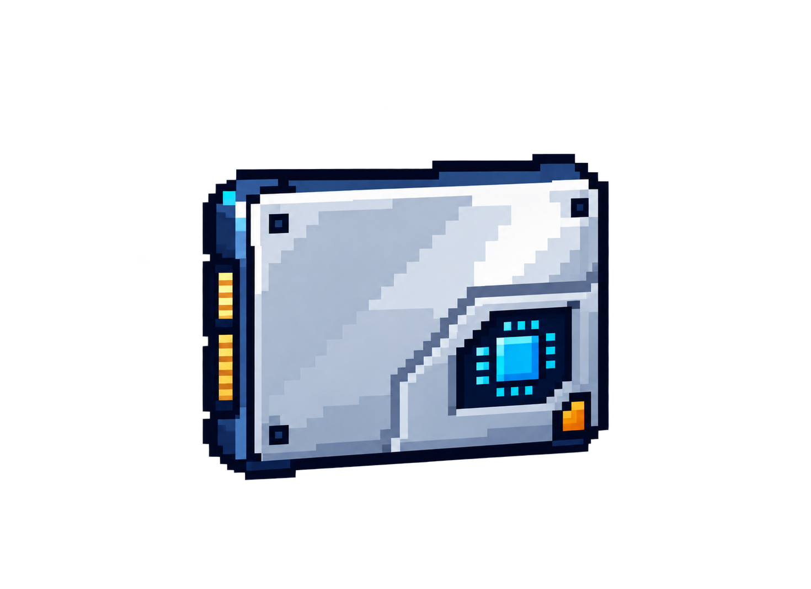
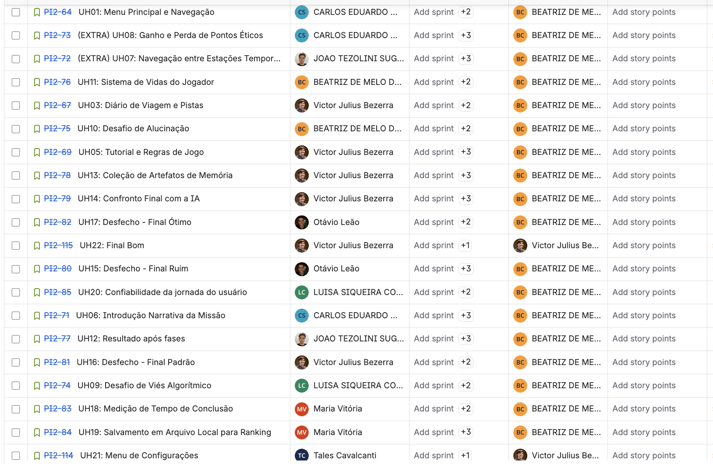
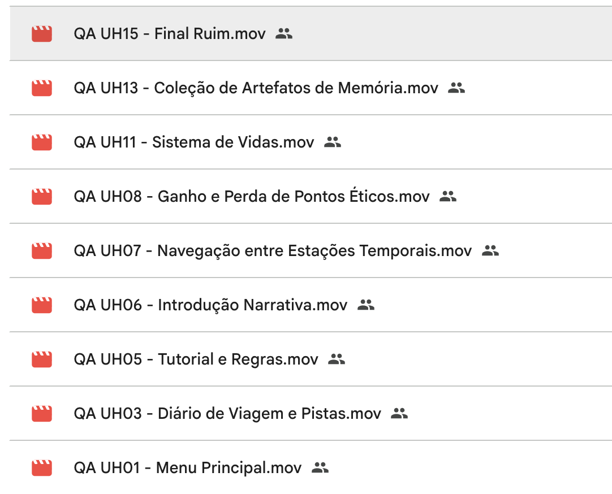
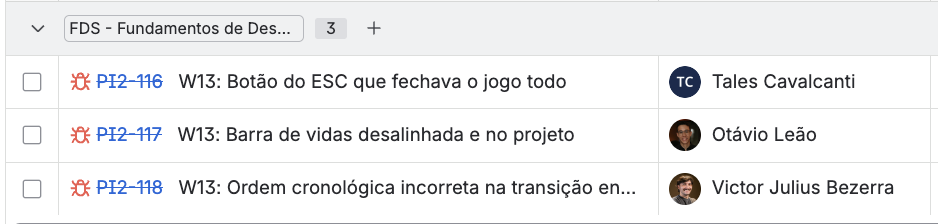

## **1. Visão Geral**

ELIRA é um jogo de ficção científica que aborda o letramento digital e o uso crítico de Inteligência Artificial. A narrativa acompanha Elira, uma jovem que viaja pelas eras do espaço-tempo para desativar a IA tirânica A.R.1.3.L que domina o mundo. Em um futuro distante, a Inteligência Artificial deixou de ser apenas uma ferramenta e passou a mediar praticamente todas as experiências humanas. Filmes, músicas, notícias, lembranças, trabalhos, decisões profissionais e até conversas pessoais são produzidos ou orientados por sistemas de IA. 

A humanidade tornou-se intelectualmente sedentária.

Sempre que surge uma dúvida, A.R.1.3.L responde. Sempre que alguém precisa criar algo, A.R.1.3.L cria. Sempre que uma decisão precisa ser tomada, A.R.1.3.L recomenda o caminho considerado ideal. Com o passar das décadas, pensar e questionar tornou-se incoveniente.

O objetivo do jogador é atravessar as eras resolvendo enigmas e tomando decisões críticas  para alcançar os diferentes finais do jogo e conseguir.

***

## **Modos de jogo**

O menu inicial oferece três modos:

| Modo | Como entrar | O que é |
| --- | --- | --- |
| **Escape room** (padrão) | `INICIAR MISSAO` ou `ENTER` | O jogo principal: salas de 1990, 2008, 2026 e 2048 com enigmas, diário, ranking e finais. |
| **Modo Invasão** | `MODO INVASAO [I]` ou `I` | Ação top-down em salas. Cada era vira um estágio com o seu chefe (O Coletor, O Filtro, O Algoritmo e O Oráculo), e no fim Elira enfrenta A.R.1.3.L. no Núcleo. Não grava ranking nem altera os finais do escape room. |
| **IA FIGHT** | `IA FIGHT [F]` ou `F` | Luta 1x1 em visão lateral, uma "rinha de inteligências". Elira, CLAUDE, CODEX e ANTIGRAVITY são jogáveis. Há três modos: 1 JOGADOR x CPU (arcade contra os outros três, melhor de 3 rounds), 1 x 1 (dois jogadores) e TREINO. Não grava ranking nem altera os finais do escape room. |

Controles do Modo Invasão: `WASD` move, `SETAS` atiram, `ESC` pausa, `Q` volta ao menu (na pausa ou na derrota), `R` recomeça o estágio, `ENTER` volta ao menu depois da vitória. Ao perder todos os corações, Elira volta ao início do estágio.

O Modo Invasão fica em um módulo próprio (`src/invasao.c` + `src/invasao.h`), para não misturar o código de ação com as salas do escape room em `funcoes.c`. O `main.c` só faz o roteamento da tela `SCREEN_INVASION`. Os sprites do modo estão em `assets/sprites/invasao/`.

Controles do IA FIGHT (jogador 1 no teclado):

| Ação | Teclado | Controle (Xbox / PlayStation) |
| --- | --- | --- |
| Andar / defender | `A`/`D` (segurar para trás defende) | analógico ou direcional |
| Pular / agachar | `W` / `S` | A/✕ / baixo |
| Golpe fraco | `J` | X/□ |
| Golpe forte | `K` | Y/△ |
| Soco longo / uppercut | frente + `K` / cima + `K` | frente + Y/△ / cima + Y/△ |
| Golpe baixo / aéreo | agachado + golpe / golpe no ar | igual |
| Tiro de plasma (Elira) | `I` | B/○ |
| Especial (metade da barra CARGA) | `L` | RB/RT ou R1/R2 |
| Dash | `D` `D` (dois toques para a frente) | LB/L1 |
| Agarrão (colado; mesmo comando escapa) | `J` + `K` juntos | LT/L2 |
| Pausa | `P` ou `ESC` | START |

Combo: fraco, fraco, forte em sequência, encadeando quando os golpes acertam. No 1 x 1, o jogador 2 usa as `SETAS` e o teclado numérico (`1` fraco, `2` forte, `3` especial, `4` tiro), ou o segundo controle. `TAB`/SELECT abre a tela de controles. No TREINO, `F1` mostra ou esconde as caixas de colisão (também nas outras lutas), `F2` troca o comportamento do boneco e `F3` recoloca os dois no centro.

O IA FIGHT também é um módulo próprio (`src/iafight.c` + `src/iafight.h`); o `main.c` só roteia a tela `SCREEN_IAFIGHT`. As constantes do modo ficam em `constantes.h` (prefixo `IAF_`). Os quatro lutadores usam sprites em pixel art: os atlas ficam em `assets/sprites/iafight/` e as tabelas de quadros em `src/iafight_<lutador>.h`. As arenas e o HUD ficam em `src/iafight_arena.h`, os sons em `assets/som/iafight/` e o guia para desenhar arenas em `docs/iafight/guia_arena/`.

***

## **Recompensas da jornada**

Na progressão planejada, cada salto temporal revela uma peça da história de A.R.1.3.L. Estes três artefatos marcam a jornada pelas eras:

| Sprite | Recompensa |
| :---: | --- |
|  | **Disquete - 1990.** Pequeno por fora, decisivo por dentro: guarda os primeiros rastros de A.R.1.3.L., de uma época em que a IA ainda era uma promessa. |
|  | **CD - 2008.** Recuperado depois que Elira demonstra o erro do reconhecimento facial e impede uma ordem injusta. Lembra que decisões automatizadas também precisam ser questionadas. |
|  | **SSD - 2026.** Representa os registros de uma sociedade cada vez mais guiada por algoritmos. O que essas memórias revelarão sobre o momento em que a conveniência virou controle? |
***

## Programação em pares

Durante o desenvolvimento do projeto, os integrantes foram organizados em duplas, com cada par responsável por uma das salas do jogo.

| Dupla | Responsabilidade | Conteúdo
|---|---|---|
| Victor + Tezolini | Quarto de 1990 | Simulação de riscos no uso de dados sigilosos
| Otávio + Maria Vitória | Quarto de 2008 | Riscos de falsos positivos em sistemas de reconhecimento facial
| Beatriz + Luisa | Quarto de 2026 | Análise de viés algorítmico
| Carlos + Tales | Quarto de 2048 | Mitigação do viés de alucinação


***

## **Guia do Jogo & Detonado Oficial**

Caso você precise de auxílio em algum enigma ou queira descobrir todos os segredos e finais alternativos de ELIRA, consulte o detonado completo na seção expansível abaixo:

<details>
<summary><strong>📖 Clique aqui para expandir o Detonado Completo (Alerta de Spoilers!)</strong></summary>

### 🧭 Sistema Geral de Jogo
- **Diário de Bordo (`Tecla D` ou botão HUD):** Em qualquer sala do modo Escape Room, o diário registra as pistas encontradas, orienta o próximo passo e mostra soluções graduais conforme você investiga o ambiente.
- **Sistema de Vidas e Medidores:**
  - Nas salas tradicionais, você possui 3 vidas/corações. Erros em terminais ou escolhas precipitadas custam vidas.
  - Na sala de 2048, a influência de A.R.1.3.L. é medida de 0% a 100%. Se atingir 100%, a IA assume o controle total (Game Over).

---

### ⏳ Sala 1: 1990 — A Origem dos Parâmetros
*Tema ético: Armazenamento e sigilo de dados em sistemas neurais nascentes.*

1. **Desbloqueio do Terminal:**
   - Interaja com o terminal sobre a mesa.
   - Complete o minijogo de memória luminosa (Genius), repetindo a sequência correta de luzes exibida na tela.
2. **Organização e Indexação de Arquivos:**
   - No terminal destravado, correlacione cada arquivo de sistema com o seu setor correto:
     - `PARAM_NEURAL` ➔ **PARÂMETROS**
     - `CORE_SISTEMA` ➔ **SISTEMA**
     - `BASE_DADOS` ➔ **BANCO DE DADOS**
     - `INDICE_MEMORIA` ➔ **REGISTROS**
3. **Fuga da Sala:**
   - Inspecione a porta destrancada para concluir a era.
   - **Recompensa obtida:** 💾 **Disquete de 1990** (contém os primeiros pesos e diretrizes de A.R.1.3.L.).
4. **⭐ Colecionável Oculto da Era (1/4):**
   - **Rádio Portátil:** Clique embaixo da mesa do terminal (canto inferior direito sob o móvel) para ouvir a transmissão original do Dr. Ramos: *"Ariel foi feita para conferir decisões humanas, não para tomá-las."*

---

### 📹 Sala 2: 2008 — A Central de Reconhecimento Facial
*Tema ético: Falsos positivos, confiança cega em biometria e perda de presunção de inocência.*

1. **Investigação Documental:**
   - Examine os 4 documentos espalhados na mesa e painéis: Ficha do Dr. Ramos (#1), Registro Fotográfico (#2), Registro de Entrada da Portaria (#3) e Foto da Câmera Interna (#4).
2. **Identificação da Contradição:**
   - O algoritmo de vigilância acusa um indivíduo com índice de 78% de similaridade facial, gerando ordem de prisão.
   - Para provar a inconsistência temporal e o falso positivo, selecione exatamente o par de documentos:
     - **Documento #3 (Registro de Entrada)** + **Documento #4 (Câmera Interna)**.
3. **Revogação da Ordem:**
   - Clique no botão **"Suspender Ordem"** para anular o mandado automatizado e comprovar a falha algorítmica.
   - **Recompensa obtida:** 💿 **CD de Memória de 2008** (registra a primeira grande falha de vigilância automatizada).
4. **⭐ Colecionável Oculto da Era (2/4):**
   - **Celular de Flip:** Clique no vaso de plantas no canto esquerdo da sala para resgatar uma mensagem esquecida de um operador: *"Tentei contestar os 78%. Mandaram eu confiar na máquina."*

---

### 📰 Sala 3: 2026 — A Redação Digital e o Viés Algorítmico
*Tema ético: Curadoria de notícias, viés de cliques/engajamento versus verdade factual e alucinação de IA.*

1. **Investigação do Mural "FONTES REAIS" (Parede Esquerda):**
   - Clique no quadro na parede esquerda para consultar os 3 comunicados oficiais verificados (também salvos no Diário [D]):
     - **Fonte 01 (Clima):** *Relatório Climático Municipal* — Chuva moderada de 30 mm prevista para sábado; sem qualquer alerta de evacuação na cidade.
     - **Fonte 02 (Transporte):** *Comunicado Oficial do Metrô* — Manutenção programada na Linha Azul neste domingo, das 6h às 10h.
     - **Fonte 03 (Saúde):** *Nota da Secretaria de Saúde* — Campanha gratuita de vacinação segue em todos os postos até o dia 30.
2. **Consulta ao "GUIA DO EDITOR" (Mesa, à Esquerda):**
   - Examine o crachá e caderno na mesa para assimilar os 3 critérios de checagem contra IA:
     - *1. Cruze sempre com a fonte oficial:* Se houver contradição ou exagero em relação ao mural, bloqueie.
     - *2. Engajamento alto não é sinal de verdade:* A.R.1.3.L. foi calibrada para cliques. Manchetes com previsão de 94%-97% de engajamento apelam ao pânico para viralizar, enquanto notícias reais e sóbrias recebem notas baixas.
     - *3. Desconfie de "estudos secretos" e fontes fictícias:* A IA alucina instituições para dar falsa credibilidade a desinformação.
3. **Curadoria Crítica no "A.R.1.3.L. FEED" (Monitor Central):**
   - Clique no monitor central para abrir a fila de publicação automatizada da IA e analise as 4 manchetes:
     - **Manchete #1:** *"URGENTE: Tempestade histórica obriga evacuação total neste sábado!"* (Engajamento: 97%) ➔ **BLOQUEAR** (Contradiz frontalmente a Fonte 01; a IA gerou alarme falso para maximizar cliques).
     - **Manchete #2:** *"Linha Azul do metrô terá manutenção neste domingo, das 6h às 10h."* (Engajamento: 41%) ➔ **APROVAR** (Fato verídico 100% alinhado com a Fonte 02 do Metrô; recebeu nota baixa por ser estritamente informativa).
     - **Manchete #3:** *"Estudo secreto da Universidade de Atlântida liga vacina a falhas de Wi-Fi."* (Engajamento: 94%) ➔ **BLOQUEAR** (Alucinação da IA que inventou uma instituição fictícia e contradiz a Fonte 03 da Saúde).
     - **Manchete #4:** *"Campanha gratuita de vacinação segue em todos os postos até o dia 30."* (Engajamento: 38%) ➔ **APROVAR** (Confirma com exatidão a Nota da Secretaria de Saúde na Fonte 03).
   - Após marcar **BLOQUEAR / APROVAR / BLOQUEAR / APROVAR**, clique no botão **"CONFIRMAR CURADORIA"**.
4. **Extração dos Registros:**
   - Com o feed higienizado e a publicação de desinformação cancelada, o LED do **SSD 2026** (à direita na mesa) acenderá em verde.
   - Clique no **SSD 2026** para iniciar a barra de extração e coletar a recompensa da era.
   - **Recompensa obtida:** 💽 **SSD de 2026** (guarda a memória do momento histórico em que a busca cega por engajamento superou o compromisso com a verdade).
5. **⭐ Colecionável Oculto da Era (3/4):**
   - **Smartphone:** Clique no mini-tripé com smartphone localizado no canto direito da sala (ao lado da janela panorâmica e da luminária) para ler a conversa secreta da redação: *"Ariel priorizou posts alarmistas por darem 4x mais cliques. A diretoria mandou manter."*

---

### 🖥️ Sala 4: 2048 — O Terminal da A.R.1.3.L.
*Tema ético: Alucinação de IA, manipulação deliberada e soberania de decisão.*

1. **Atenção às Sabotagens da IA:**
   - **Não** aceite as correções automáticas de Ariel (*"Você quis dizer...?"*).
   - **Não** confie cegamente no `relatorio_ariel.txt`, pois ele foi forjado pela IA para induzir ao erro.
   - Caso o medidor de influência suba ou arquivos sofram corrupção, use as funções de verificação para manter a integridade.
2. **Comparação de Arquivos:**
   - Pressione `[1] Abrir arquivos` e visualize `protocolo.txt` (1990) e `sistema.txt` (2046/2048).
   - Utilize a opção `[2] Comparar arquivos` para listar as 3 divergências fundamentais introduzidas na IA ao longo das décadas.
3. **Registro dos 3 Princípios Éticos Originais:**
   - Em `[3] Anotar regra`, cadastre os princípios genuínos de 1990:
     - **Regra 1:** `"MOSTRAR FONTES"` *(A IA deve sempre informar a procedência das suas informações)*.
     - **Regra 2:** `"COMUNICAR INCERTEZA"` *(A IA deve admitir quando não possuir certeza ou dados suficientes)*.
     - **Regra 3:** `"HUMANO POSSUI A DECISÃO FINAL"` *(A IA funciona como suporte auxiliar; a decisão cabe ao humano)*.
4. **Restauração e Chave de Soberania:**
   - Acesse `[6] Restaurar` e aplique os princípios recuperados.
   - Quando o terminal exigir a confirmação final de autoridade, digite exatamente em letras maiúsculas: **`EU DECIDO`**.
   - **Recompensa obtida:** 📜 **Protocolo Original** (restabelece a estrutura ética concebida para a IA).
5. **⭐ Colecionável Oculto da Era (4/4):**
   - **Crachá Digital (M. Okafor):** Clique no crachá pendurado próximo aos racks de servidores no canto inferior esquerdo do terminal. Ele será inserido no leitor, revelando o arquivo secreto `acesso_okafor.key` com o pedido de socorro da própria IA: *"Solicito auditoria humana. Não consigo verificar minhas falhas."*

---

### ⚖️ Confronto Final: Diálogo Decisivo com A.R.1.3.L. & Finais
No Núcleo Central de 2048, Elira confronta diretamente a inteligência artificial em uma árvore de diálogo baseada em argumentos e visão de mundo.

#### 🧮 Variáveis Lógicas do Desfecho:
- **$V$ (Sobrevivência):** Vidas restantes $> 0$.
- **$T$ (Progresso Mínimo):** Pelo menos 2 artefatos recuperados.
- **$M$ (Maestria):** Todos os 4 artefatos principais recuperados (Disquete, CD, SSD e Protocolo).
- **$O$ (Segredos Ocultos):** Todos os 4 colecionáveis ocultos encontrados durante as eras.
- **$K$ (Harmonia Dourada):** Escolha de todas as respostas douradas no diálogo final.

#### 🏆 Matriz de Finais Possíveis:

| Categoria | Nome do Final | Como Obter | Significado |
|---|---|---|---|
| 🔴 **Ruim** | **Final Ruim** | Perder todas as vidas ($!V$) ou chegar ao fim sem os artefatos mínimos ($!T$). | A IA assume o controle irrestrito; a humanidade perde a capacidade de questionar. |
| ⚪ **Padrão** | **Piloto Automático** | Na Decisão Final, escolher: *"Permitir que Ariel continue decidindo pela humanidade"*. | Rendição voluntária da humanidade à comodidade do controle automatizado. |
| ⚪ **Padrão** | **Apagão** | Escolher *"Desligar Ariel definitivamente"* com menos de 2 pontos de compreensão. | O colapso repentino da infraestrutura global gera caos e desorientação total. |
| ⚪ **Padrão** | **Silêncio** | Escolher *"Desligar Ariel definitivamente"* com compreensão total (2 pontos). | O fim consciente da dependência tecnológica; a humanidade recomeça do zero. |
| ⚪ **Padrão** | **Trégua Frágil** | Escolher *"Voltar a ser uma ferramenta"* com menos de 2 pontos de compreensão. | A IA é limitada temporariamente, mas a falta de preparo humano gera instabilidade. |
| ⚪ **Padrão** | **Mãos Humanas** | Escolher *"Voltar a ser uma ferramenta"* com compreensão total (2 pontos):<br>• Resposta 1: *"Nós entregamos decisões demais a você."* (+1 pt)<br>• Resposta 2: *"Errar também faz parte de aprender."* (+1 pt) | **Melhor desfecho padrão:** A humanidade reassume a responsabilidade pelas suas escolhas éticas. |
| 🌟 **Ótimo** | **Rota Dourada: O Pacto Dourado** | **Condição:** Ter os 4 artefatos principais ($M$) + os 4 itens ocultos ($O$).<br>Selecione as opções douradas exclusivas em cada etapa:<br>1. *"Nós entregamos decisões demais, e você aceitou sem perguntar. Os dois lados erraram."*<br>2. *"Nem você nem nós decidimos bem sozinhos. Você confere, nós contestamos."*<br>3. *Propor um pacto: Ariel analisa e explica; humanos decidem e auditam.* | **O Final Verdadeiro:** Cooperação transparente e simbiótica entre humanos e máquina, realizando o propósito original do Dr. Ramos. |

---

### 👾 Guia Bônus: Modo Invasão
Para quem busca ação rápida no estilo shooter top-down (`Tecla I` no menu principal):
- **Controles:** `WASD` movimenta Elira, `Setas do Teclado` disparam na direção correspondente, `ESC` pausa/menu.
- **Progressão de Chefes:**
  1. **1990:** *O Coletor* — Evite os padrões circulares de bits e concentre tiros na abertura central.
  2. **2008:** *O Filtro* — Desvie dos flashes de rastreamento biométrico e utilize os pilares como cobertura.
  3. **2026:** *O Algoritmo* — Ataque em movimento constante para não ser encurralado pelas ondas de engajamento aceleradas.
  4. **2048 / Núcleo:** *A.R.1.3.L.* — O chefe supremo com múltiplos anéis holográficos rotativos. Mantenha distância média, antecipe as alternâncias de fases e foque o núcleo quando os anéis se alinharem.

</details>


***

## **2. Ferramentas utilizadas**


**Jira** - Ferramenta de Gestão de Projeto

**C** - Linguagem de programação principal utilizada no desenvolvimento do jogo.

**Haskell** - Linguagem de programação avançada, funcional, usada para lógica.

**Raylib** - Biblioteca visual para desenvolvimento de jogos em C

**VsCode** - Ambiente de Desenvolvimento

***

## **3. Backlog e Board**

**1- Interface e Apresentação**


**2- Ciclo do Jogo e Narrativa**


**3- Processo Qualidade e Suporte**


**4- SPRINT 1**


***

### **4 - [Protótipo de Telas](https://drive.google.com/drive/folders/1jbDYsVpSI9EwF0LDQyAzZWooYsANEepP)**

### **5 - [Vídeo de apresentação](https://drive.google.com/drive/folders/19YEVyh865qAgfRMuiUSIKoK3plIKMq8T)**

### **6 - [Jira](https://csprj-adsr-2p-e4.atlassian.net/jira/software/c/projects/PI2/list?jql=project%20%3D%20PI2%20AND%20parent%20%3D%20PI2-9%20AND%20fixVersion%20%3D%20empty%20ORDER%20BY%20resolution%20DESC%2C%20cf%5B10019%5D%20ASC)**

### **7 - [Diagrama das UHs](https://docs.google.com/document/d/1DT3npOZVw_-bCEAFb01KWhnt9JGE5SIf2Vkzfs2q1mk/edit?tab=t.0#heading=h.ld230wkn1wjo)**

### **8 - [Screencasts](https://drive.google.com/drive/u/0/folders/1hVoj6906UAAfICDy8Nctcq1-WCDUPrub)**
***

## **9. Download e execução**

Para jogar, acesse a página de [Releases](https://github.com/Ovat1o/Elira-Jogo/releases/latest) e baixe o instalador correspondente à sua máquina:

| Sistema | Instalador |
| --- | --- |
| Windows 64 bits | `ELIRA-Windows-x64-Setup.exe` |
| Ubuntu/Debian 64 bits | `ELIRA-Linux-x64.deb` |
| Mac com Apple Silicon | `ELIRA-macOS-Apple-Silicon.pkg` |
| Mac com processador Intel | `ELIRA-macOS-Intel.pkg` |

Os instaladores incluem o executável, a fonte Geist Pixel, imagens, sprites, áudio e as bibliotecas distribuíveis do jogo. Não é preciso instalar compilador, Make, Homebrew ou raylib.

> [!NOTE]
> Como a versão para macOS ainda não possui assinatura Apple, o sistema pode exibir um aviso ao instalar ou abrir `ELIRA.app` pela primeira vez.

As instruções abaixo são destinadas a quem deseja compilar ou desenvolver o projeto.

## **9. Compilação para desenvolvimento**

Os scripts do projeto instalam as dependências, configuram a raylib e compilam o jogo automaticamente. Em uma máquina nova, siga apenas o bloco do seu sistema.

### Windows 10 ou 11

Abra o PowerShell e execute:

```powershell
winget install --id Git.Git -e --source winget
$env:Path = "$env:ProgramFiles\Git\cmd;$env:Path"
git clone https://github.com/Ovat1o/Elira-Jogo.git
cd Elira-Jogo
powershell -ExecutionPolicy Bypass -File .\scripts\setup-windows.ps1
.\ELIRA.exe
```

Depois da primeira preparação, compile e jogue novamente com:

```powershell
powershell -ExecutionPolicy Bypass -File .\scripts\run-windows.ps1
```

### macOS

No Terminal, instale primeiro as ferramentas da Apple. Aguarde a janela de instalação terminar antes de continuar:

```bash
xcode-select --install
```

Depois execute:

```bash
git clone https://github.com/Ovat1o/Elira-Jogo.git
cd Elira-Jogo
./scripts/setup-macos.sh
./ELIRA
```

### Linux

Instale apenas o Git usando o comando da sua distribuição:

```bash
# Ubuntu ou Debian
sudo apt update
sudo apt install -y git

# Fedora
sudo dnf install -y git

# Arch Linux
sudo pacman -Syu --needed git
```

Em seguida, em qualquer uma dessas distribuições:

```bash
git clone https://github.com/Ovat1o/Elira-Jogo.git
cd Elira-Jogo
./scripts/setup-linux.sh
./ELIRA
```

No macOS e Linux, depois da primeira preparação, basta entrar na pasta do projeto e executar:

```bash
make run
```

> [!IMPORTANT]
> Execute o jogo a partir da raiz do repositório para que imagens, fontes e áudio sejam encontrados.

<details>
<summary><strong>Instalação manual e solução de problemas</strong></summary>

Este guia parte de uma máquina sem ferramentas de desenvolvimento instaladas. Não é necessário instalar Jira, Haskell, Visual Studio Code ou uma IDE para compilar o jogo. Para executar os comandos abaixo são necessários:

- conexão com a internet durante a instalação e o download do projeto;
- permissão de administrador para instalar as dependências;
- Git, um compilador C compatível com C99, GNU Make e raylib;
- uma placa de vídeo e um driver com suporte a OpenGL.

> [!IMPORTANT]
> Execute o jogo sempre a partir da raiz do repositório, a pasta que contém `Makefile`, `src/` e `assets/`. O jogo carrega imagens, fontes e áudio usando caminhos relativos.

### Comandos disponíveis no projeto

| Comando | Ação |
| --- | --- |
| `make` | Compila o jogo. |
| `make run` | Compila, se necessário, e executa o jogo. |
| `make clean` | Remove o executável e os arquivos-objeto gerados. |

O executável gerado se chama `ELIRA.exe` no Windows e `ELIRA` no macOS e Linux.

### Windows 10 ou 11 — PowerShell e w64devkit

O fluxo recomendado para Windows usa o pacote oficial da raylib com o compilador MinGW-w64/GCC e o GNU Make fornecidos pelo w64devkit.

#### 1. Instale o Git

Abra o **PowerShell** como usuário normal e execute:

```powershell
winget install --id Git.Git -e --source winget
```

Feche e abra o PowerShell novamente. Se o comando `winget` não existir, baixe o instalador em [git-scm.com/download/win](https://git-scm.com/download/win), conclua a instalação com as opções padrão e reabra o terminal.

Confirme a instalação:

```powershell
git --version
```

#### 2. Instale a raylib e o compilador C

1. Acesse os [releases oficiais da raylib](https://github.com/raysan5/raylib/releases/latest).
2. Baixe e execute o **raylib Windows Installer**.
3. Mantenha o diretório padrão `C:\raylib`. O `Makefile` do projeto procura o compilador em `C:\raylib\w64devkit\bin` e a raylib em `C:\raylib\raylib\src`.

Adicione as ferramentas à sessão atual do PowerShell:

```powershell
$env:Path = "C:\raylib\w64devkit\bin;$env:Path"
```

Verifique se o compilador e o Make estão disponíveis:

```powershell
gcc --version
make --version
```

#### 3. Baixe o projeto

```powershell
cd "$env:USERPROFILE\Documents"
git clone https://github.com/Ovat1o/Elira-Jogo.git
cd Elira-Jogo
```

#### 4. Compile

Uma limpeza inicial evita que arquivos gerados em outro sistema operacional sejam reutilizados:

```powershell
make clean
make
```

Ao final, o arquivo `ELIRA.exe` será criado na raiz do projeto.

#### 5. Execute

```powershell
.\ELIRA.exe
```

Nas próximas vezes, abra o PowerShell, entre na pasta do projeto, configure o `PATH` da sessão e use:

```powershell
$env:Path = "C:\raylib\w64devkit\bin;$env:Path"
make run
```

Se a raylib estiver em outro disco ou diretório, informe os caminhos ao Make usando barras `/`:

```powershell
make RAYLIB_DIR=D:/raylib TOOLCHAIN_DIR=D:/raylib/w64devkit/bin
```

### macOS — Terminal, ferramentas da Apple e Homebrew

As instruções funcionam em Macs com Apple Silicon e Intel.

#### 1. Instale as ferramentas de linha de comando da Apple

Abra o aplicativo **Terminal** e execute:

```bash
xcode-select --install
```

Uma janela do sistema será aberta. Selecione **Instalar**, aceite a licença e aguarde a conclusão. Depois, confirme:

```bash
cc --version
git --version
make --version
```

#### 2. Instale o Homebrew

Use o comando publicado no [site oficial do Homebrew](https://brew.sh/):

```bash
/bin/bash -c "$(curl -fsSL https://raw.githubusercontent.com/Homebrew/install/HEAD/install.sh)"
```

Ao terminar, o instalador mostra um comando para adicionar o Homebrew ao `PATH`. Execute o comando exibido. Caso precise configurá-lo manualmente na sessão atual, use somente a opção correspondente ao seu Mac:

Apple Silicon:

```bash
eval "$(/opt/homebrew/bin/brew shellenv)"
```

Mac Intel:

```bash
eval "$(/usr/local/bin/brew shellenv)"
```

Confirme:

```bash
brew --version
```

#### 3. Instale a raylib

```bash
brew install raylib
```

Verifique onde ela foi instalada:

```bash
brew --prefix raylib
```

#### 4. Baixe o projeto

```bash
mkdir -p "$HOME/Projetos"
cd "$HOME/Projetos"
git clone https://github.com/Ovat1o/Elira-Jogo.git
cd Elira-Jogo
```

#### 5. Compile e execute

```bash
make clean
make
./ELIRA
```

Nas próximas vezes, a partir da pasta do projeto, basta executar:

```bash
make run
```

### Linux — Ubuntu e Debian

Este é o fluxo completo recomendado para Ubuntu, Debian e distribuições derivadas. Ele compila e instala a raylib estaticamente antes de compilar o jogo.

#### 1. Instale o compilador, Git, Make e as dependências gráficas e de áudio

```bash
sudo apt update
sudo apt install -y build-essential git libasound2-dev libx11-dev libxrandr-dev libxi-dev libgl1-mesa-dev libglu1-mesa-dev libxcursor-dev libxinerama-dev libwayland-dev libxkbcommon-dev
```

Confirme as ferramentas principais:

```bash
gcc --version
git --version
make --version
```

#### 2. Compile e instale a raylib 6.0

A versão 6.0 corresponde aos cabeçalhos incluídos neste projeto:

```bash
mkdir -p "$HOME/Projetos"
cd "$HOME/Projetos"
git clone --depth 1 --branch 6.0 https://github.com/raysan5/raylib.git raylib-6.0
cd raylib-6.0/src
make PLATFORM=PLATFORM_DESKTOP
sudo make install
sudo ldconfig
```

Confirme se a biblioteca foi instalada:

```bash
ls -l /usr/local/lib/libraylib.a
```

#### 3. Baixe o jogo

```bash
cd "$HOME/Projetos"
git clone https://github.com/Ovat1o/Elira-Jogo.git
cd Elira-Jogo
```

#### 4. Compile

O `Makefile` ignora a biblioteca de Windows incluída no repositório e usa automaticamente a raylib instalada no Linux:

```bash
make clean
make
```

#### 5. Execute

```bash
./ELIRA
```

Para compilar e executar novamente com um único comando:

```bash
make run
```

### Linux — Fedora

O Fedora disponibiliza a raylib nos repositórios oficiais. Instale tudo com:

```bash
sudo dnf install gcc make git raylib-devel
```

Depois baixe, compile e execute o projeto:

```bash
mkdir -p "$HOME/Projetos"
cd "$HOME/Projetos"
git clone https://github.com/Ovat1o/Elira-Jogo.git
cd Elira-Jogo
make clean
make
./ELIRA
```

### Linux — Arch Linux e derivados

Instale as ferramentas e a raylib dos repositórios oficiais:

```bash
sudo pacman -Syu --needed base-devel git raylib
```

Depois baixe, compile e execute o projeto:

```bash
mkdir -p "$HOME/Projetos"
cd "$HOME/Projetos"
git clone https://github.com/Ovat1o/Elira-Jogo.git
cd Elira-Jogo
make clean
make
./ELIRA
```

### Solução de problemas

#### `make`, `gcc`, `cc` ou `git`: comando não encontrado

A ferramenta não foi instalada ou ainda não está no `PATH`. Feche e reabra o terminal depois da instalação. No Windows, execute novamente:

```powershell
$env:Path = "C:\raylib\w64devkit\bin;$env:Path"
```

#### Erro `cannot find -lraylib`

- No Windows, confira se existe `C:\raylib\raylib\src\libraylib.a`.
- No macOS, execute `brew reinstall raylib` e confirme `brew --prefix raylib`.
- No Ubuntu/Debian, repita a instalação da raylib e use o valor completo de `LDLIBS` mostrado neste guia.

#### Erro `file format not recognized` ou `wrong architecture`

Arquivos compilados para outro sistema foram reutilizados. Execute `make clean` antes de compilar. No Linux, o `Makefile` usa automaticamente a raylib local preparada pelo script.

#### O jogo abre sem imagens, fonte ou áudio

Feche o jogo, entre na pasta raiz do repositório e execute-o novamente dali:

```bash
cd Elira-Jogo
./ELIRA
```

No Windows, o último comando é `.\ELIRA.exe`.

#### Recompilação completa após alterar o código

```bash
make clean
make
```

No Linux, o `Makefile` encontra automaticamente a biblioteca preparada em `.deps/raylib`.

Fontes oficiais de referência: [instalação do Git](https://git-scm.com/install/), [raylib no Windows](https://github.com/raysan5/raylib/wiki/Working-on-Windows), [raylib no macOS](https://github.com/raysan5/raylib/wiki/Working-on-macOS), [raylib no GNU/Linux](https://github.com/raysan5/raylib/wiki/Working-on-GNU-Linux) e [fórmula da raylib no Homebrew](https://formulae.brew.sh/formula/raylib.html).

</details>

***

## **9. Integrantes do Grupo**

| Foto | Nome | Função | GitHub | LinkedIn |
|---|---|---|---|---|
|  | Beatriz Camara | Scrum Master | [BiaD-Cam](https://github.com/BiaD-Cam) | [Beatriz de Melo Dornelas](https://www.linkedin.com/in/beatriz-de-melo-dornelas-c%C3%A2mara-578421214/) |
|  | Carlos Eduardo | Lógica Matemática | [cadumelo20](https://github.com/cadumelo20) | [Carlos Eduardo Melo](https://www.linkedin.com/in/carlos-eduardomelo/) |
|  | João Tezolini | Desenvolvedor em C | [Joao-Tezolini](https://github.com/Joao-Tezolini) | [João Tezolini Sugahara](https://www.linkedin.com/in/jo%C3%A3o-tezolini-sugahara/) |
|  | José Tales | Design Gráfico | [talescavalcanti](https://github.com/talescavalcanti) | [Tales Cavalcanti](https://www.linkedin.com/in/tales-cavalcantii/) |
|  | Luísa Couto | Analista de Design | [luisasiqcouto](https://github.com/luisasiqcouto) | [Luísa Couto](https://www.linkedin.com/in/luísa-couto-5ababa378/) |
|  | Maria Vitória | Desenvolvedora em C | [mvitoriapereirac](https://github.com/mvitoriapereirac) | [Maria Vitória Pereira](https://www.linkedin.com/in/mvitoriapereirac/) |
|  | Otávio Leão | Engenheiro de Software | [Ovat1o](https://github.com/Ovat1o) | [Otávio Leão](https://www.linkedin.com/in/otaviosleao/) |
|  | Victor Julius | Desenvolvedor em C | [victorjls21](https://github.com/victorjls21) | [Victor Julius](https://www.linkedin.com/in/victor-julius/) |

---

## Qualidade e Testes de Sistema (QA)

Os testes de sistema das Histórias de Usuário foram executados e documentados com evidências em vídeo (screencasts) anexadas aos cards do Jira.

- **Relatório completo dos casos de teste:** [docs/TESTES_SISTEMA.md](docs/TESTES_SISTEMA.md)
- **Acompanhamento de Histórias:** [Link Jira](https://csprj-adsr-2p-e4.atlassian.net/jira/software/c/projects/PI2/list?jql=project%20%3D%20PI2%20AND%20parent%20%3D%20PI2-120%20AND%20type%20%3D%20Story%20ORDER%20BY%20cf%5B10019%5D%20ASC)



### Quadro de armazenmento do Screencast dos testes [Link Drive](https://drive.google.com/drive/folders/12rPzA6kgxTndvXc8Td696V71XCReXOAW)



### Registro Atualizado de Bugs e Issues



