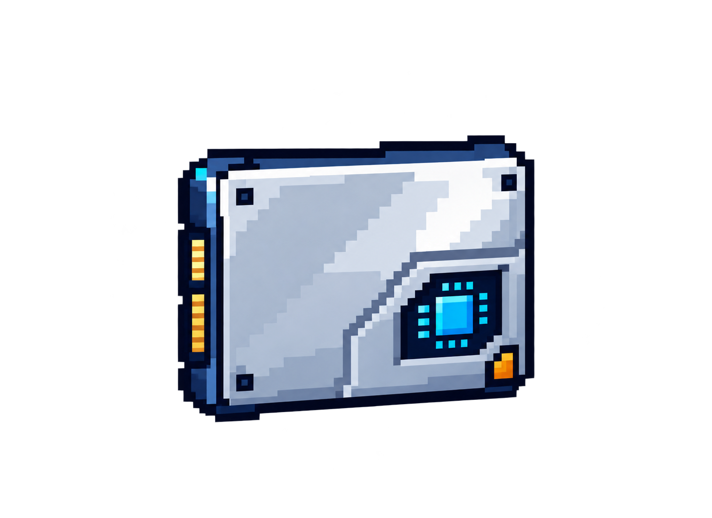

## **1. Visão Geral**

ELIRA é um jogo de ficção científica que aborda o letramento digital e o uso crítico de Inteligência Artificial. A narrativa acompanha Elira, uma jovem que viaja pelas eras do espaço-tempo para desativar a IA tirânica A.R.1.3.L que domina o mundo. Em um futuro distante, a Inteligência Artificial deixou de ser apenas uma ferramenta e passou a mediar praticamente todas as experiências humanas. Filmes, músicas, notícias, lembranças, trabalhos, decisões profissionais e até conversas pessoais são produzidos ou orientados por sistemas de IA. 

A humanidade tornou-se intelectualmente sedentária.

Sempre que surge uma dúvida, A.R.1.3.L responde. Sempre que alguém precisa criar algo, A.R.1.3.L cria. Sempre que uma decisão precisa ser tomada, A.R.1.3.L recomenda o caminho considerado ideal. Com o passar das décadas, pensar e questionar tornou-se incoveniente.

O objetivo do jogador é atravessar as eras resolvendo enigmas e tomando decisões críticas  para alcançar os diferentes finais do jogo e conseguir.

***

## **Recompensas da jornada**

Na progressão planejada, cada salto temporal revela uma peça da história de A.R.1.3.L. Estes três artefatos marcam a jornada pelas eras:

| Sprite | Recompensa |
| :---: | --- |
|  | **Disquete - 1990.** Pequeno por fora, decisivo por dentro: guarda os primeiros rastros de A.R.1.3.L., de uma época em que a IA ainda era uma promessa. |
|  | **CD - 2008.** Recuperado depois que Elira demonstra o erro do reconhecimento facial e impede uma ordem injusta. Lembra que decisões automatizadas também precisam ser questionadas. |
|  | **SSD - 2026.** Representa os registros de uma sociedade cada vez mais guiada por algoritmos. O que essas memórias revelarão sobre o momento em que a conveniência virou controle? |

***

## **2. Ferramentas utilizadas**


**Jira** - Ferramenta de Gestão de Projeto

**C** - Linguagem de programação principal utilizada no desenvolvimento do jogo.

**Haskell** - Linguagem de programação avançada, funcional, usada para lógica.

**Raylib** - Biblioteca visual para desenvolvimento de jogos em C

**VsCode** - Ambiente de Desenvolvimento

***

## **3. Backlog e Board**

**1- Interface e Apresentação**


**2- Ciclo do Jogo e Narrativa**


**3- Processo Qualidade e Suporte**


***

### **4 - [Protótipo de Telas](https://drive.google.com/drive/folders/1jbDYsVpSI9EwF0LDQyAzZWooYsANEepP)**

### **5 - [Vídeo de apresentação](https://drive.google.com/drive/folders/19YEVyh865qAgfRMuiUSIKoK3plIKMq8T)**

### **6 - [Jira](https://csprj-adsr-2p-e4.atlassian.net/jira/software/c/projects/PI2/list?jql=project%20%3D%20PI2%20AND%20parent%20%3D%20PI2-9%20AND%20fixVersion%20%3D%20empty%20ORDER%20BY%20resolution%20DESC%2C%20cf%5B10019%5D%20ASC)**

### **7 - [Diagrama das UHs](https://docs.google.com/document/d/1DT3npOZVw_-bCEAFb01KWhnt9JGE5SIf2Vkzfs2q1mk/edit?tab=t.0#heading=h.ld230wkn1wjo)**

***

## **8. Instalação, compilação e execução**

Os scripts do projeto instalam as dependências, configuram a raylib e compilam o jogo automaticamente. Em uma máquina nova, siga apenas o bloco do seu sistema.

### Windows 10 ou 11

Abra o PowerShell e execute:

```powershell
winget install --id Git.Git -e --source winget
$env:Path = "$env:ProgramFiles\Git\cmd;$env:Path"
git clone https://github.com/Ovat1o/Elira-Jogo.git
cd Elira-Jogo
powershell -ExecutionPolicy Bypass -File .\scripts\setup-windows.ps1
.\ELIRA.exe
```

Depois da primeira preparação, compile e jogue novamente com:

```powershell
powershell -ExecutionPolicy Bypass -File .\scripts\run-windows.ps1
```

### macOS

No Terminal, instale primeiro as ferramentas da Apple. Aguarde a janela de instalação terminar antes de continuar:

```bash
xcode-select --install
```

Depois execute:

```bash
git clone https://github.com/Ovat1o/Elira-Jogo.git
cd Elira-Jogo
./scripts/setup-macos.sh
./ELIRA
```

### Linux

Instale apenas o Git usando o comando da sua distribuição:

```bash
# Ubuntu ou Debian
sudo apt update
sudo apt install -y git

# Fedora
sudo dnf install -y git

# Arch Linux
sudo pacman -Syu --needed git
```

Em seguida, em qualquer uma dessas distribuições:

```bash
git clone https://github.com/Ovat1o/Elira-Jogo.git
cd Elira-Jogo
./scripts/setup-linux.sh
./ELIRA
```

No macOS e Linux, depois da primeira preparação, basta entrar na pasta do projeto e executar:

```bash
make run
```

> [!IMPORTANT]
> Execute o jogo a partir da raiz do repositório para que imagens, fontes e áudio sejam encontrados.

<details>
<summary><strong>Instalação manual e solução de problemas</strong></summary>

Este guia parte de uma máquina sem ferramentas de desenvolvimento instaladas. Não é necessário instalar Jira, Haskell, Visual Studio Code ou uma IDE para compilar o jogo. Para executar os comandos abaixo são necessários:

- conexão com a internet durante a instalação e o download do projeto;
- permissão de administrador para instalar as dependências;
- Git, um compilador C compatível com C99, GNU Make e raylib;
- uma placa de vídeo e um driver com suporte a OpenGL.

> [!IMPORTANT]
> Execute o jogo sempre a partir da raiz do repositório, a pasta que contém `Makefile`, `src/` e `assets/`. O jogo carrega imagens, fontes e áudio usando caminhos relativos.

### Comandos disponíveis no projeto

| Comando | Ação |
| --- | --- |
| `make` | Compila o jogo. |
| `make run` | Compila, se necessário, e executa o jogo. |
| `make clean` | Remove o executável e os arquivos-objeto gerados. |

O executável gerado se chama `ELIRA.exe` no Windows e `ELIRA` no macOS e Linux.

### Windows 10 ou 11 — PowerShell e w64devkit

O fluxo recomendado para Windows usa o pacote oficial da raylib com o compilador MinGW-w64/GCC e o GNU Make fornecidos pelo w64devkit.

#### 1. Instale o Git

Abra o **PowerShell** como usuário normal e execute:

```powershell
winget install --id Git.Git -e --source winget
```

Feche e abra o PowerShell novamente. Se o comando `winget` não existir, baixe o instalador em [git-scm.com/download/win](https://git-scm.com/download/win), conclua a instalação com as opções padrão e reabra o terminal.

Confirme a instalação:

```powershell
git --version
```

#### 2. Instale a raylib e o compilador C

1. Acesse os [releases oficiais da raylib](https://github.com/raysan5/raylib/releases/latest).
2. Baixe e execute o **raylib Windows Installer**.
3. Mantenha o diretório padrão `C:\raylib`. O `Makefile` do projeto procura o compilador em `C:\raylib\w64devkit\bin` e a raylib em `C:\raylib\raylib\src`.

Adicione as ferramentas à sessão atual do PowerShell:

```powershell
$env:Path = "C:\raylib\w64devkit\bin;$env:Path"
```

Verifique se o compilador e o Make estão disponíveis:

```powershell
gcc --version
make --version
```

#### 3. Baixe o projeto

```powershell
cd "$env:USERPROFILE\Documents"
git clone https://github.com/Ovat1o/Elira-Jogo.git
cd Elira-Jogo
```

#### 4. Compile

Uma limpeza inicial evita que arquivos gerados em outro sistema operacional sejam reutilizados:

```powershell
make clean
make
```

Ao final, o arquivo `ELIRA.exe` será criado na raiz do projeto.

#### 5. Execute

```powershell
.\ELIRA.exe
```

Nas próximas vezes, abra o PowerShell, entre na pasta do projeto, configure o `PATH` da sessão e use:

```powershell
$env:Path = "C:\raylib\w64devkit\bin;$env:Path"
make run
```

Se a raylib estiver em outro disco ou diretório, informe os caminhos ao Make usando barras `/`:

```powershell
make RAYLIB_DIR=D:/raylib TOOLCHAIN_DIR=D:/raylib/w64devkit/bin
```

### macOS — Terminal, ferramentas da Apple e Homebrew

As instruções funcionam em Macs com Apple Silicon e Intel.

#### 1. Instale as ferramentas de linha de comando da Apple

Abra o aplicativo **Terminal** e execute:

```bash
xcode-select --install
```

Uma janela do sistema será aberta. Selecione **Instalar**, aceite a licença e aguarde a conclusão. Depois, confirme:

```bash
cc --version
git --version
make --version
```

#### 2. Instale o Homebrew

Use o comando publicado no [site oficial do Homebrew](https://brew.sh/):

```bash
/bin/bash -c "$(curl -fsSL https://raw.githubusercontent.com/Homebrew/install/HEAD/install.sh)"
```

Ao terminar, o instalador mostra um comando para adicionar o Homebrew ao `PATH`. Execute o comando exibido. Caso precise configurá-lo manualmente na sessão atual, use somente a opção correspondente ao seu Mac:

Apple Silicon:

```bash
eval "$(/opt/homebrew/bin/brew shellenv)"
```

Mac Intel:

```bash
eval "$(/usr/local/bin/brew shellenv)"
```

Confirme:

```bash
brew --version
```

#### 3. Instale a raylib

```bash
brew install raylib
```

Verifique onde ela foi instalada:

```bash
brew --prefix raylib
```

#### 4. Baixe o projeto

```bash
mkdir -p "$HOME/Projetos"
cd "$HOME/Projetos"
git clone https://github.com/Ovat1o/Elira-Jogo.git
cd Elira-Jogo
```

#### 5. Compile e execute

```bash
make clean
make
./ELIRA
```

Nas próximas vezes, a partir da pasta do projeto, basta executar:

```bash
make run
```

### Linux — Ubuntu e Debian

Este é o fluxo completo recomendado para Ubuntu, Debian e distribuições derivadas. Ele compila e instala a raylib estaticamente antes de compilar o jogo.

#### 1. Instale o compilador, Git, Make e as dependências gráficas e de áudio

```bash
sudo apt update
sudo apt install -y build-essential git libasound2-dev libx11-dev libxrandr-dev libxi-dev libgl1-mesa-dev libglu1-mesa-dev libxcursor-dev libxinerama-dev libwayland-dev libxkbcommon-dev
```

Confirme as ferramentas principais:

```bash
gcc --version
git --version
make --version
```

#### 2. Compile e instale a raylib 6.0

A versão 6.0 corresponde aos cabeçalhos incluídos neste projeto:

```bash
mkdir -p "$HOME/Projetos"
cd "$HOME/Projetos"
git clone --depth 1 --branch 6.0 https://github.com/raysan5/raylib.git raylib-6.0
cd raylib-6.0/src
make PLATFORM=PLATFORM_DESKTOP
sudo make install
sudo ldconfig
```

Confirme se a biblioteca foi instalada:

```bash
ls -l /usr/local/lib/libraylib.a
```

#### 3. Baixe o jogo

```bash
cd "$HOME/Projetos"
git clone https://github.com/Ovat1o/Elira-Jogo.git
cd Elira-Jogo
```

#### 4. Compile

O `Makefile` ignora a biblioteca de Windows incluída no repositório e usa automaticamente a raylib instalada no Linux:

```bash
make clean
make
```

#### 5. Execute

```bash
./ELIRA
```

Para compilar e executar novamente com um único comando:

```bash
make run
```

### Linux — Fedora

O Fedora disponibiliza a raylib nos repositórios oficiais. Instale tudo com:

```bash
sudo dnf install gcc make git raylib-devel
```

Depois baixe, compile e execute o projeto:

```bash
mkdir -p "$HOME/Projetos"
cd "$HOME/Projetos"
git clone https://github.com/Ovat1o/Elira-Jogo.git
cd Elira-Jogo
make clean
make
./ELIRA
```

### Linux — Arch Linux e derivados

Instale as ferramentas e a raylib dos repositórios oficiais:

```bash
sudo pacman -Syu --needed base-devel git raylib
```

Depois baixe, compile e execute o projeto:

```bash
mkdir -p "$HOME/Projetos"
cd "$HOME/Projetos"
git clone https://github.com/Ovat1o/Elira-Jogo.git
cd Elira-Jogo
make clean
make
./ELIRA
```

### Solução de problemas

#### `make`, `gcc`, `cc` ou `git`: comando não encontrado

A ferramenta não foi instalada ou ainda não está no `PATH`. Feche e reabra o terminal depois da instalação. No Windows, execute novamente:

```powershell
$env:Path = "C:\raylib\w64devkit\bin;$env:Path"
```

#### Erro `cannot find -lraylib`

- No Windows, confira se existe `C:\raylib\raylib\src\libraylib.a`.
- No macOS, execute `brew reinstall raylib` e confirme `brew --prefix raylib`.
- No Ubuntu/Debian, repita a instalação da raylib e use o valor completo de `LDLIBS` mostrado neste guia.

#### Erro `file format not recognized` ou `wrong architecture`

Arquivos compilados para outro sistema foram reutilizados. Execute `make clean` antes de compilar. No Linux, o `Makefile` usa automaticamente a raylib local preparada pelo script.

#### O jogo abre sem imagens, fonte ou áudio

Feche o jogo, entre na pasta raiz do repositório e execute-o novamente dali:

```bash
cd Elira-Jogo
./ELIRA
```

No Windows, o último comando é `.\ELIRA.exe`.

#### Recompilação completa após alterar o código

```bash
make clean
make
```

No Linux, o `Makefile` encontra automaticamente a biblioteca preparada em `.deps/raylib`.

Fontes oficiais de referência: [instalação do Git](https://git-scm.com/install/), [raylib no Windows](https://github.com/raysan5/raylib/wiki/Working-on-Windows), [raylib no macOS](https://github.com/raysan5/raylib/wiki/Working-on-macOS), [raylib no GNU/Linux](https://github.com/raysan5/raylib/wiki/Working-on-GNU-Linux) e [fórmula da raylib no Homebrew](https://formulae.brew.sh/formula/raylib.html).

</details>

***

## **9. Integrantes do Grupo**

| Foto | Nome | Função | GitHub | LinkedIn |
|---|---|---|---|---|
|  | Beatriz Camara | Scrum Master | [BiaD-Cam](https://github.com/BiaD-Cam) | [Beatriz de Melo Dornelas](https://www.linkedin.com/in/beatriz-de-melo-dornelas-c%C3%A2mara-578421214/) |
|  | Carlos Eduardo | Lógica Matemática | [cadumelo20](https://github.com/cadumelo20) | [Carlos Eduardo Melo](https://www.linkedin.com/in/carlos-eduardomelo/) |
|  | João Tezolini | Desenvolvedor em C | [Joao-Tezolini](https://github.com/Joao-Tezolini) | [João Tezolini Sugahara](https://www.linkedin.com/in/jo%C3%A3o-tezolini-sugahara/) |
|  | José Tales | Design Gráfico | [talescavalcanti](https://github.com/talescavalcanti) | [Tales Cavalcanti](https://www.linkedin.com/in/tales-cavalcantii/) |
|  | Luísa Couto | Analista de Design | [luisasiqcouto](https://github.com/luisasiqcouto) | [Luísa Couto](https://www.linkedin.com/in/luísa-couto-5ababa378/) |
|  | Maria Vitória | Desenvolvedora em C | [mvitoriapereirac](https://github.com/mvitoriapereirac) | [Maria Vitória Pereira](https://www.linkedin.com/in/mvitoriapereirac/) |
|  | Otávio Leão | Engenheiro de Software | [Ovat1o](https://github.com/Ovat1o) | [Otávio Leão](https://www.linkedin.com/in/otaviosleao/) |
|  | Victor Julius | Desenvolvedor em C | [victorjls21](https://github.com/victorjls21) | [Victor Julius](https://www.linkedin.com/in/victor-julius/) |
